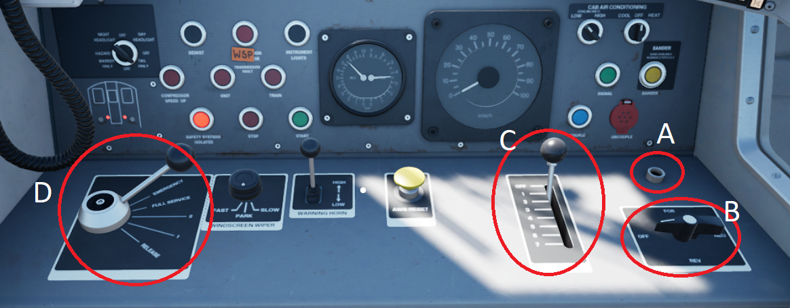
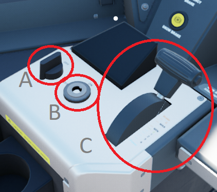
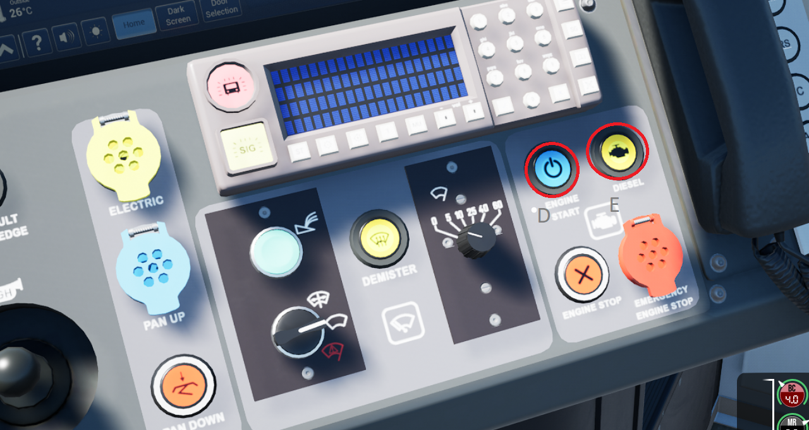

# TSW6 — GWR Guide

## GWR Trains
### Class 150/2 & Class 802 Guide

---

# Class 150/2

## Overview

The British Rail Class 150/2 (Sprinter) is a diesel multiple unit passenger train operated by Great Western Railway.

It's a workhorse on regional routes, known for its reliability and frequent stops.

---

## Key Specifications (By Default)

- **Max Speed:** 160 km/h (100 mph)
- **Passenger Capacity:** 319 seats
- **Power:** 2 x Cummins LT10 diesel engines
- **Length:** 52.43 m
- **Weight:** 68 tonnes

---

## Dashboard

---

## Controls & Systems

### A. Master Key

Activates the train's electrical systems and allows engine start.

**States:**
- Locked
- Unlocked

---

### B. Reverser

Controls the direction of the train.

**States:**
- Off
- Forward
- Reverse
- Neutral

---

### C. Throttle

Regulates engine power and speed.

**States:**
- Off
- 1-7

---

### D. Brake

Controls the train's braking system.

**States:**
- Emergency
- Full Service
- 2
- 1
- Release

---

# How to Operate

1. Insert the master key.
2. Turn the master key to the **"Unlocked"** position.
3. Make sure the brake is in the **"Release"** position.
4. Set the reverser to **"Forward"** or **"Reverse"**.
5. Gradually increase the throttle to accelerate.

---

# Class 802

## Overview

The British Rail Class 802 is a high-speed intercity train used by Great Western Railway.

It combines modern performance, passenger comfort, and advanced systems for mainline services.

---

## Key Specifications

- **Max Speed:** 200 km/h (125 mph)
- **Passenger Capacity:** 579 seats
- **Power:** Electric (AC 25 kV overhead)
- **Length:** 200.68 m (9-car formation)
- **Weight:** 470 tonnes (9-car formation)

---

## Dashboard

---

# Controls & Systems

## A. Reverser

Controls the direction of the train.

**States:**
- Off
- Forward
- Reverse
- Neutral

---

## B. Master Key

Activates the train's electrical systems and allows engine start.

**States:**
- Locked
- Unlocked

---

## C. Power Handle

Manages the power output from the traction motors.

**States:**
- Emergency
- 100-0% Brake
- 1-4 Throttle

---

## D. Engine Start Button

Turns the engine on.

---

## E. Diesel Button

Changes from electrical to diesel mode.

---

# How to Operate

1. Insert the master key.
2. Turn the master key to the **"Unlocked"** position.
3. Look over to the other panel.
4. Hold the engine start button for about 10 seconds (or until you hear the engine start).
5. Press the diesel button to switch to diesel mode.
6. Return to the left side panel.
7. Set the reverser to **"Forward"** or **"Reverse"**.
8. Gradually increase the power handle to accelerate.