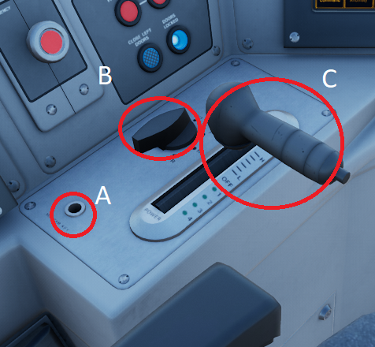

# TSW6 — XC Class 220 DMF Guide

## XC CLASS 220 DMF
### Driver Guide & Operating Notes

---

# Overview

## XC Class 220 DMF

The Class 220 DMF is a CrossCountry diesel multiple unit with strong acceleration and a top speed of 125 mph.

It is designed for intercity express services with a compact driver desk and responsive traction.

In Train Sim World 6, the 220 is best for fast mainline runs where keeping speed and managing service braking are the key skills.

---

# Key Specifications

- **Top Speed:** 125 mph / 200 km/h
- **Formation:** 4-car set
- **Seating:** Approx. 155 passengers
- **Power Type:** DMU with four diesel engines
- **Braking:** Electro-pneumatic and air brake control
- **Role:** Long-distance intercity services

---

# Startup & Controls

## Controls

---

### A. Master Key

Powers the cab and enables traction systems.

---

### B. Reverser

Selects the direction of the train.

**States:**
- Neutral
- Forward
- Reverse

---

### C. Power Handle

Sets the traction power notch for acceleration.

---

# Startup Procedure

1. Insert the master key.
2. Turn the master key to the **"Unlocked"** position.
3. Set the reverser to the desired direction (**Forward** or **Reverse**).
4. Gradually increase the power handle to accelerate.
5. Monitor speed and adjust braking as needed for stops.